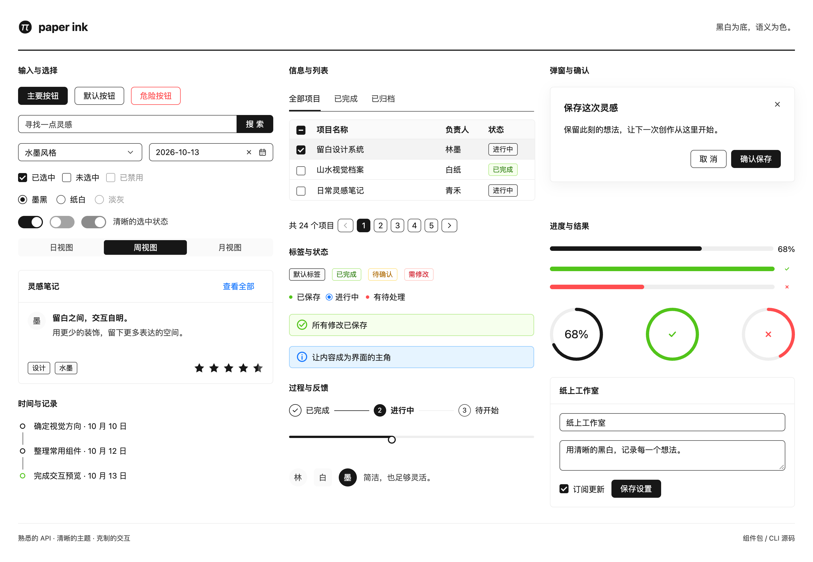

# Paper Ink

**以黑白为底、语义为色的轻量 React 组件库。**

Paper Ink 追求清晰、克制的水墨风格：足够对比度的黑白、淡色边界，以及简洁的交互。常用组件 API 参考 Ant Design，提供组件包和 CLI 源码安装两种使用方式，既能直接使用，也能将源码带回项目自由修改。

[](https://tingxi8087.github.io/paper-ink/#/showcase)

[在线文档](https://tingxi8087.github.io/paper-ink/) · [组件画廊](https://tingxi8087.github.io/paper-ink/#/showcase) · [快速开始](https://tingxi8087.github.io/paper-ink/#/guide) · [主题实验室](https://tingxi8087.github.io/paper-ink/#/theme)

> 首个公开版本为 **0.1.0**。面向 React 18+、ReactDOM 和 TypeScript 项目。

## 为什么选择 Paper Ink

- **聚焦常用能力。** 精简 API 的重复配置，支持组件 JS 与 CSS 按需引入；React 和 ReactDOM 为 peer dependencies，不打包进组件库。
- **追求更少的包装层。** 使用简洁的 DOM 与 CSS，减少不必要的节点嵌套，便于理解结构、覆盖样式和调试。这是设计原则，不代表所有组件都比其他库节点更少。
- **包与源码两种分发。** 包引入方便统一升级；CLI 按需安装组件源码、共享模块和所需依赖，适合二次开发。
- **极简的默认风格。** 黑白主色、清晰对比度、统一 SVG 图标与克制动效，链接和状态保留必要的语义色。
- **熟悉的 API，明确的范围。** 常用属性参考 Ant Design；复杂的 Form、Table、布局和 Upload 按轻量思路独立设计，各组件文档列出支持的 API 与边界。
- **清晰的主题结构。** 按视觉用途组织主题变量，支持 ConfigProvider、嵌套继承和组件覆盖；主题实验室可以直接试验与导出配置。
- **可以实际体验的文档。** 交互案例、在线 JSX 编辑预览、组件画廊与主题工具，帮助你确认组件是否适合自己的项目。
- **MIT 开源。** TypeScript 源码、公开类型与行为测试，使用和修改自由。

“轻量”指聚焦能力、按需分发与可理解的实现。当前 Button 示例测量为 JS **1,944 bytes**、CSS **1,318 bytes**（gzip；JS 经 esbuild 打包压缩，React / ReactDOM 外置，CSS 为构建后的独立样式）。可用 `pnpm check:size` 复测；不同组件会带入各自需要的依赖，这不是与其他库的对比基准。

## 安装与使用

### 方式一：组件包

在已有 React 项目中，选择项目使用的包管理器安装：

```bash
npm install paper-ink
# 或 cnpm install paper-ink
# 或 yarn add paper-ink
# 或 pnpm add paper-ink
```

React 和 ReactDOM 需要由项目提供；已有 React 项目一般已安装。

在应用中导入组件和样式：

```tsx
import { Button, Input, Stack } from 'paper-ink';
import 'paper-ink/style.css';

export default function App() {
  return (
    <Stack gap="medium">
      <Input placeholder="输入一些文字" />
      <Button type="primary">保存</Button>
    </Stack>
  );
}
```

也可以只引入需要的组件与样式：

```tsx
import { Button } from 'paper-ink/button';
import 'paper-ink/button/style.css';
```

组件 CSS 子路径包含该组件所需的样式依赖。全量样式和按需样式选择一种即可。React 与 ReactDOM 由消费项目提供。

### 方式二：CLI 安装源码

在你的 React + TypeScript 项目根目录执行：

```bash
npx @tingxi8087/paper-ink-cli init
npx @tingxi8087/paper-ink-cli add button input --dry-run
npx @tingxi8087/paper-ink-cli add button input
```

也可以使用 `pnpm dlx @tingxi8087/paper-ink-cli`。CLI 需要 Node.js 20+，无需安装组件包即可使用本地源码。

从目标项目的 `src/App.tsx` 引入：

```tsx
import { Button, Input } from './components/paper-ink';
import './components/paper-ink/style.css';

export default function App() {
  return <><Input placeholder="可以直接修改组件源码" /><Button>保存</Button></>;
}
```

有 `src` 时默认安装到 `src/components/paper-ink`，否则为 `components/paper-ink`。可用 `init --path src/ui/paper-ink` 自定义目录；已有 `@/` 别名也可用于引入，CLI 不修改项目别名。

CLI 自动解析共享模块与组件依赖，支持 `list`、`--dry-run` 和 `--no-install`。再次安装保留已修改文件；无归属的冲突文件会停止安装，明确传入 `--overwrite` 才覆盖。请将源码、`paper-ink.json` 与 `paper-ink.lock.json` 一起提交。当前没有自动合并上游修改的更新命令。

包与源码分别拥有主题上下文，同一个组件树中建议保持一种来源。源码分发细节见 [分发说明](doc/distribution.md) 和 [CLI 文档](packages/cli/README.md)。

<details>
<summary>从仓库构建安装（组件开发与离线分发）</summary>

要求 Node.js 22.12+、pnpm 10：

```bash
git clone https://github.com/tingxi8087/paper-ink.git
cd paper-ink
pnpm install
pnpm --filter paper-ink build
pnpm --dir packages/paper-ink pack --pack-destination ../../.artifacts
```

将生成的 tgz 文件复制到消费项目后执行 `npm install ./paper-ink-0.1.0.tgz`。本仓库也可通过 `pnpm build:registry` 与 `pnpm cli` 使用未发布的本地 CLI 源码。

</details>

## 组件与工具

| 类型 | 代表组件 |
| --- | --- |
| 通用与布局 | Button、Typography、Divider、Stack、Inline、SimpleGrid、Layout、Splitter |
| 数据录入 | Input / Search / Password / TextArea、Select、AutoComplete、Checkbox、Radio、Switch、InputNumber、Slider、Rate、DatePicker、TimePicker、ColorPicker、Upload |
| 数据展示 | Card、Avatar、Badge、Tag、Descriptions、Statistic、Image、Timeline、Table |
| 导航与反馈 | Menu、Tabs、Breadcrumb、Steps、Pagination、Dropdown、Tooltip、Popover、Popconfirm、Modal、Drawer、Alert、Message、Notification、Progress、Spin、Skeleton、Empty、Result |
| 状态与业务工具 | Form、ConfigProvider、App、useBasePageTable、useTableChecked、useRefState、useLocalstorageState、useUpload |

这是概览，不代表完整实现对应 Ant Design API。具体用法、示例与支持范围以 [在线文档](https://tingxi8087.github.io/paper-ink/) 为准。组件规划见 [状态清单](doc/component-priorities.md)。

## 图标

> 新增图标入口与 CLI 条目已在源码实现，待下一版 npm 发布；当前 0.1.0 尚不包含，可从仓库构建体验。

公开图标库采用 [Tabler Icons](https://tabler.io/icons)，MIT 许可。安装 Paper Ink 时会自动安装依赖，不需要单独安装图标包：

```tsx
import { IconSearch, IconPlus } from 'paper-ink/icons';
import { Button } from 'paper-ink';

<IconSearch size={20} stroke={2} />;
<Button icon={<IconPlus size={16} />}>新建</Button>;
```

保留 Tabler 官方组件名称和属性，支持按需打包，无图标 CSS 和额外包装节点。[图标目录](https://tingxi8087.github.io/paper-ink/#/icons)支持搜索、筛选、复制代码与居中辅助线。

源码安装：`npx @tingxi8087/paper-ink-cli add tabler-icons`，CLI 自动处理依赖。

## 与 Ant Design 的关系

Paper Ink 的常用组件 API 与交互习惯参考 [Ant Design](https://ant.design/)，采用独立实现，不依赖 `antd`；提供常用 API 子集，主题及部分复杂组件采用独立设计。它不是 Ant Design 的完整替代，也不保证直接迁移所有现有用法。

感谢 Ant Design 提供的设计与 API 参考。项目使用的 Day.js、@ctrl/tinycolor 和 @rc-component/mini-decimal 等依赖各自遵循其开源许可证。

## 本地开发与验证

```bash
pnpm install
pnpm dev

pnpm typecheck
pnpm test
pnpm build
pnpm check:size
pnpm check:package
PLAYWRIGHT_CHANNEL=chrome pnpm check:cli
PLAYWRIGHT_CHANNEL=chrome pnpm test:browser
```

文档站地址以终端输出为准。浏览器测试可使用本机 Chrome；使用 Playwright Chromium 时先执行 `pnpm exec playwright install chromium`，再运行 `pnpm test:browser`。

| 目录 | 用途 |
| --- | --- |
| `packages/paper-ink` | 组件实现、类型、样式和行为测试 |
| `packages/cli` / `registry` | 源码安装 CLI 与分发清单 |
| `apps/website` | 官网、组件文档、案例和主题实验室 |
| `doc` | 设计方案与组件支持状态 |
| `tests/browser` / `scripts` | 浏览器、体积、组件包与 CLI 消费验证 |

## 文档部署

文档通过 [GitHub Pages](https://tingxi8087.github.io/paper-ink/) 托管。推送到 `main` 后，GitHub Actions 自动完成类型检查、构建和部署；也可手动触发 `Deploy documentation`。工作流见 [.github/workflows/pages.yml](.github/workflows/pages.yml)。

网站使用 Hash 路由与相对资源路径，支持静态子目录部署。在线案例的数据与保存是本地演示，不连接业务后台。

## 贡献与许可

欢迎提交问题、改进建议与 Pull Request。实现前请阅读 [设计文档](doc/README.md)，明确组件 API、主题和支持边界；新增能力需要同步类型、示例与测试，新增组件或状态变更需同步组件清单。

[MIT License](LICENSE)。
